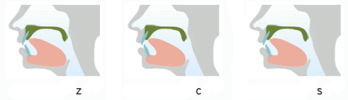
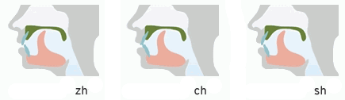
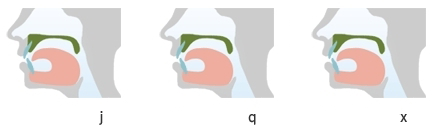

###### Grammar

## Phonetics ##

# Consonants

  <th></th>
  <th>Labio labial</th>
  <th>Labio dental</th>
  <th>Alveolar &nbsp;</th>
  <th>Palatal</th>
  <th>Alveo palatal</th>
  <th>Velar &nbsp;</th>

  <th>Stop non aspirated</th>
b&ensp;[p]

d&ensp;[t]

g&ensp;[k]

<th>Stop aspirated</th>
p&ensp;[pʰ]

t&ensp;[tʰ]

k&ensp;[kʰ]

<th>Affricate non aspirated</th>
z&ensp;[ts]

zh&ensp;[ʈʂ]

j&ensp;[tɕ]

<th>Affricate aspirated</th>
c&ensp;[tsʰ]

ch&ensp;[ʈʂʰ]

q&ensp;[tɕʰ]

<th>Fricative</th>
f&ensp;[f]

s&ensp;[s]

sh&ensp;[ʂ]

r&ensp;[ʐ~ɻ]

x&ensp;[ɕ]

h&ensp;[x]

<th>Nasal</th>
m&ensp;[m]

n&ensp;[n]

<th>Lateral</th>
l&ensp;[l]

<th>Sonorant</th>
y&ensp;[j]&nbsp;/&nbsp;[ɥ], w&ensp;[w]

<h5>Consonants Notes</h5>

Voiced/Voiceless consonants pairs pronounced as Aspirated/Non Aspirated pairs:

b - р 
d - t 
g - k 
z - с 
zh - ch 
j - q 

<!--

b, d, g - как [п], [т], [к] без придыхания 
р, t, k - как [п], [т], [к] с придыханием

Ь, d, g - начинать произносить voiceless [п], [т], [к], после смычки произносить звонкие [б], [д], [г]

m - как твердый [м] с большей напряженностью и длительностью

h - как твердый [х], но несколько мягче

f, s - как [ф], [с] но более интенсивны и длительны

n - как [н], язык поднят к альвеолам

l - как [л], язык поднят к альвеолам, боковые края не соприкасаются с верхними зубами

ng - как английский [ng]

 
-->

z, c, s -  tip of the tongue raised to alveoles

zh, ch, sh, r - tip of the tongue raised to palate 
zh, ch, sh - voiceless 
r - voiced

j, q, x - tip of the tongue pressed to lower teeth, sides of the tongue touch upper teeth 
x - hissing sound

