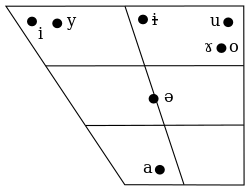

###### Grammar

# Vowels

## Monophtongs

## Diphtongs

<h5>Vowels Notes</h5>

<!--a - язык отодвинут назад, задняя часть спинки поднята -->
<!-- u - язык в переднем положении -->
e - tip of the tongue raised high to the back part of the hard palate, lips are stretched
i - previous consonnant is not softened
&emsp;zi, сi, si, zhi, chi, shi, ri - i pronounced with consonant overtone
ian, yan - pronounced  [iɛn]
o - tip of the tongue raised high to the back part of the hard palate, lips are rounded
bo, po, mo, fo - pronounced [puo], [pʰuo], [muo], [fuo]
ong - pronounced [uŋ]
ü - tongue as [i], lips as [y]
&emsp;after j, q, х - ü is written as u
&emsp;после l, n - ü is written as ü
ai, ei, ао, ou - falling diphthongs, first vowel is pronouced strong, second vowel is pronouced weak
uo - raising diphthongs,  first vowel is pronouced weak, second vowel is pronouced strong
er - as american-english [er]

<h5>Compound Finals</h5>

<th>Final</th>
<th>Nucleus</th>
<th>a</th>
<th>ə</th>
<th rowspan='2'></th>
</tr>
<tr>
<th>Coda</th>
<td></td>
<th>i</th>
<th>u</th>
<th>n</th>
<th>ŋ</th>
<td></td>
<th>i</th>
<th>u</th>
<th>n</th>
<th>ŋ</th>

<th>Medial</th>
<td>[ɑ]
a
-a</td>
<td>[aɪ̯]
ai
-ai</td>
<td>[ɑʊ̯]
ao
-ao</td>
<td>[an]
an
-an</td>
<td>[ɑŋ]
ang
-ang</td>
<td>[ɯ̯ʌ]
e
-e</td>
<td>[eɪ̯]
ei
-ei</td>
<td>[ɤʊ̯]
ou
-ou</td>
<td>[ən]
en
-en</td>
<td>[əŋ]
eng
-eng</td>
<td>[ɨ]

-i</td>

<th>i</th>
<td>[i̯ɑ]
ya
-ia</td>
<td>[i̯ɑʊ̯]
yao
-iao</td>
<td>[i̯ɛn]
yan
-ian</td>
<td>[i̯ɑŋ]
yang
-iang</td>
<td>[i̯ɛ]
ye
-ie</td>
<td>[i̯ɤʊ̯]
you
-iu</td>
<td>[in]
yin
-in</td>
<td>[iŋ]
ying
-ing</td>
<td>[i]
yi
-i</td>

<th>u</th>
<td>[u̯ɑ]
wa
-ua</td>
<td>[u̯aɪ̯]
wai
-uai</td>
<td>[u̯an]
wan
-uan</td>
<td>[u̯ɑŋ]
wang
-uang</td>
<td>[u̯ɔ]
wo
-uo/-o</td>
<td>[u̯eɪ̯]
wei
-ui</td>
<td>[u̯ən]
wen
-un</td>
<td>[u̯əŋ], [ʊŋ]
weng
-ong</td>
<td>[u]
wu
-u</td>

<th>y</th>
<td>[y̯ɛn]
yuan
-üan</td>
<td>[y̯œ]
yue
-üe</td>
<td>[yn]
yun
-ün</td>
<td>[i̯ʊŋ]
yong
-iong</td>
<td>[y]
yu
-ü</td>
