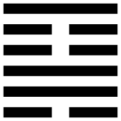

18 - £3[蠱]  Исправление (порчи)  
%[clPinYin|gǔ]

£3[蠱] £2[元]£1[亨]。£4[利]£4[涉]£4[大]£1[川]。£1[先]£3[甲]£1[三]£4[日]。£4[後]£3[甲]£1[三]£4[日]。
%[clPinYin|gǔ yuán hēng. lì shè dà chuān. xiān jiǎ sān rì. hòu jiǎ sān rì]
£1[初]£4[六] £4[幹]£4[父]£1[之]£3[蠱]。£3[有]£3[子]。£3[考]£2[无]£4[咎]。£4[厲]£1[終]£2[吉]。
%[clPinYin|chū liù gàn fù zhī gǔ. yǒu zǐ. kǎo wú jiù. lì zhōng jí]
£3[九]£4[二] £4[幹]£3[母]£1[之]£3[蠱]。£4[不]£3[可]£1[貞]。
%[clPinYin|jiǔ èr gàn mǔ zhī gǔ. bù kě zhēn]
£3[九]£1[三] £4[幹]£4[父]£1[之]£3[蠱]。£3[小]£3[有]£3[悔]。£2[无]£4[大]£4[咎]。
%[clPinYin|jiǔ sān gàn fù zhī gǔ. xiǎo yǒu huǐ. wú dà jiù]
£4[六]£4[四] £4[裕]£4[父]£1[之]£3[蠱]。£3[往]£4[見]£4[吝]。
%[clPinYin|liù sì yù fù zhī gǔ. wǎng jiàn lìn]
£4[六]£3[五] £4[幹]£4[父]£1[之]£3[蠱]。£4[用]£4[譽]。
%[clPinYin|liù wǔ gàn fù zhī gǔ. yòng yù]
£4[上]£3[九] £4[不]£4[事]£2[王]£2[侯]。£1[高]£4[尚]£2[其]£4[事]。
%[clPinYin|shàng jiǔ bù shì wáng hóu. gāo shàng qí shì]
