# 30. Сияние  

£2[離]
%[clPinYin|lí] 

---

£2[離] £4[利]£1[貞]。£1[亨]。£4[畜]£4[牝]£2[牛]。£2[吉]。
%[clPinYin|lí lì zhēn. hēng. chù pìn niú. jí]
£1[初]£3[九] £3[履]£4[錯]£2[然]。£4[敬]£1[之]。£2[无]£4[咎]。
%[clPinYin|chū jiǔ lǚ cuò rán. jìng zhī. wú jiù]
£4[六]£4[二] £2[黃]£2[離]。£2[元]£2[吉]。
%[clPinYin|liù èr huáng lí. yuán jí]
£3[九]£1[三] £4[日]£4[昃]£1[之]£2[離]。£4[不]£3[鼓]£3[缶]£2[而]£1[歌]。£2[則]£4[大]£2[耋]£1[之]£1[嗟]。£1[凶]。
%[clPinYin|jiǔ sān rì zè zhī lí. bù gǔ fǒu ér gē. zé dà dié zhī jiē. xiōng]
£3[九]£4[四] £1[突]£2[如]£2[其]£2[來]£2[如]。£2[焚]£2[如]。£3[死]£2[如]。£4[棄]£2[如]。
%[clPinYin|jiǔ sì tū rú qí lái rú. fén rú. sǐ rú. qì rú]
£4[六]£3[五] £1[出]£4[涕]£2[沱]£4[若]。£1[戚]£1[嗟]£4[若]。£2[吉]。
%[clPinYin|liù wǔ chū tì tuó ruò. qī jiē ruò. jí]
£4[上]£3[九] £2[王]£4[用]£1[出]£1[征]。£3[有]£1[嘉]。£2[折]£3[首]。£4[獲]£3[匪]£2[其]£3[醜]。£2[无]£4[咎]。
%[clPinYin|shàng jiǔ wáng yòng chū zhēng. yǒu jiā. zhé shǒu. huò fěi qí chǒu. wú jiù]

---

Сияние. Благоприятна стойкость. Свершение. Разводить коров - к счастью.

1. В начале слабая черта. Путаница поступков. Но если отнесешься к ним с серьезностью, хулы не будет. 

2. Слабая черта на втором месте. Желтое сияние. Изначальное счастье. 

3. Сильная черта на третьем месте. Сияние солнечного заката. Если не песня под постукивание по глиняному кувшину, то вздохи глубокого сердца. Несчастье. 

4. Сильная черта на четвертом месте. Внезапно наступает это! Сгорание, отмирание, отверженность. 

5. Слабая черта на пятом месте. Выступившие слезы льются потоком. Но будут сочувственные вздохи близких. Счастье. 

6. Наверху сильная черта. Царю надо выступить в карательный поход. Будет радость. Ему надо казнить главаря и переловить тех, кто не предан ему. Хулы не будет.

---

Данная гексаграмма состоит из двух триграмм, одноименных с названием гексаграммы. По символике образов «Книги Перемен» триграмма ли является знаком огня. Отсюда и название, которое указано выше. С другой стороны, с древнейших времен комментаторы указывают на то, что огонь не существует сам по себе, а он цепко держится за горящий материал. Поэтому слово ли имеет также значение «крепко держаться за что-нибудь». Поэтому комментаторская литература подчеркивает обозначение этого термина и говорит о том, что в предыдущей ситуации, где все окружение действующего человека напоминало опасность, бездну, где ничто не поддерживало его, нужно было добиться и найти внутреннюю правду. Здесь уже все это сделано и нужно только научиться крепко, держаться найденной внутренней правды. Это умение, держаться, которое в предыдущей ситуации выступает лишь как побочное качество действующего человека, здесь выделено как особая самостоятельная ситуация. Поэтому здесь говорится об умении придерживаться той истины, которая найдена в предыдущем. Придерживаться необходимо с полной стойкостью, ибо только это может гарантировать правильное развитие и свершение того, что должно быть свершено в данном положении. Кроме того, для понимания данного текста необходимо принимать во внимание, что по символике животных в «Книге Перемен» корова является податливой исполнительности, но исполнительности, не лишенной мощи. Кроме того, то, что корова может родить теленка, указывает на возможность из данной ситуации перейти к чему-то новому, иному. Только принимая это во внимание, можно понять несколько неожиданный и бессвязный образ, данный в тексте.

1. Когда наше познание направлено на приобретение новых сведений, то, несмотря на наличие знания, накопленного прежде, наши поступки и наши познавательные акты могут быть еще лишены систематичности. Здесь еще вполне возможна путаница, о которой говорит текст. Даже напряженная наша деятельность в данном состоянии может привести нас к некоторой неудовлетворительности ее, но эта неудовлетворительность, как и ошибки предыдущего опыта, должны быть уничтожены в самый момент их появления. Нужно бдительное и строгое отношение к себе, чтобы предупреждать ошибки, чем исправлять их после того, как они уже совершены.

2. Во второй гексаграмме мы уже видели на других ступенях, что желтый цвет является символом уравновешенности и серединного положения черты, которая, как известно, идет изнутри вовне. Так и качество данной позиции из внутреннего центра исходит вовне. Качество второй позиции как нельзя более совпадает с качеством данной гексаграммы в целом.

3. Поскольку третья позиция является концом нижней триграммы и переходом к следующей, постольку в ней совершенно естественно появление образа заката, будет ли это закат, понимаемый реально, или закат, понимаемый в переносном смысле. Только средняя фраза о песне, по всей вероятности, является позднейшей вставкой в текст, и поэтому ее довольно пояснить рациональным образом. Но песня-аккомпанемент такого «постукивания по глиняному кувшину», очень может быть, является также мотивом, который встречаем уже в притчах Чжуан-чзы, где говорится о том, как на закате своих дней, похоронив жену, Чжуан-чзы распевал под такой аккомпанемент.

4. В первой гексаграмме мы рассматривали четвертую позицию как сильный, внезапный порыв от прошлого к будущему. Здесь та же динамика звучит в афоризме данной черты. Все, что было, все, что найдено на предыдущих ступенях, должно сгореть и быть отвергнутым. Здесь говорится только о материале, который горит, ибо все здесь для того, чтобы само горение, горение, выраженное во второй черте.

5. Если нижняя триграмма рассматривает огонь с точки зрения его сияния, то верхняя скорее рассматривает его с точки зрения сгорания, ибо оно не внутреннее качество огня, не сам он, а лишь условие его существования. И поскольку пятая позиция больше других выражает подлинные качества верхней триграммы, постольку здесь с особенной силой дан образ сгорания. Но для наличия огня необходимо сгорание. Можно только сочувствовать тому, что сжигается. Так, можно только сочувствовать опыту предыдущего познания, который служит лишь топливом, материалом для нового познания. В общем же ситуация, взятая в контексте со второй позицией, дает утверждение счастливого исхода.

6. С одной стороны, сиянию свойственно излучение вовне, уничтожение окружающей тьмы. С другой стороны, верхняя черта символизирует выход за пределы, вне данной ситуации.

---

